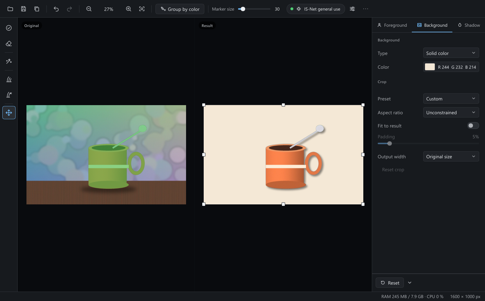
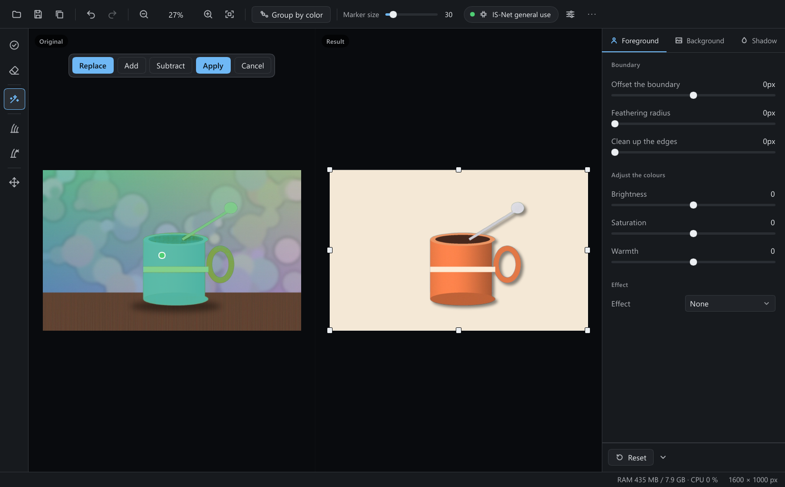
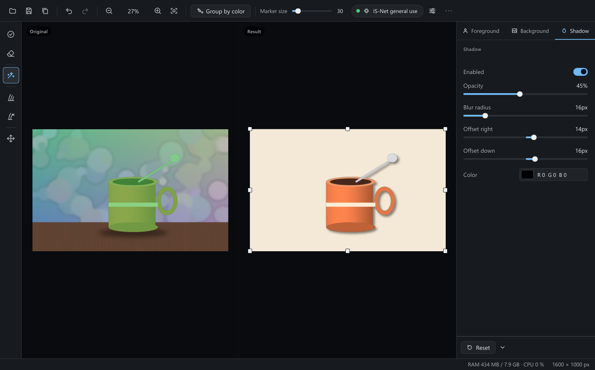
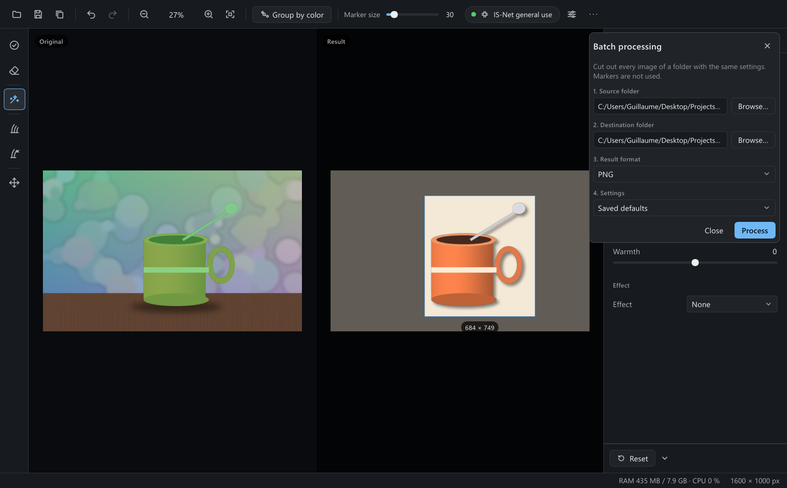
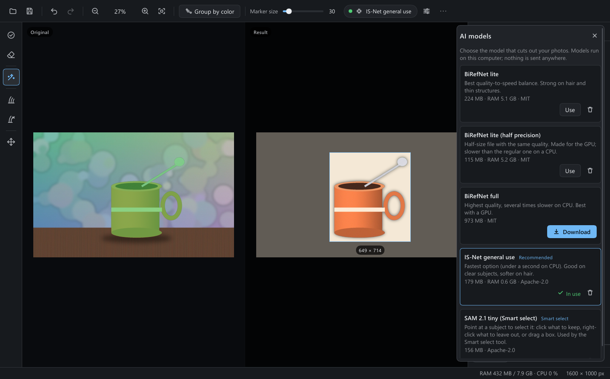
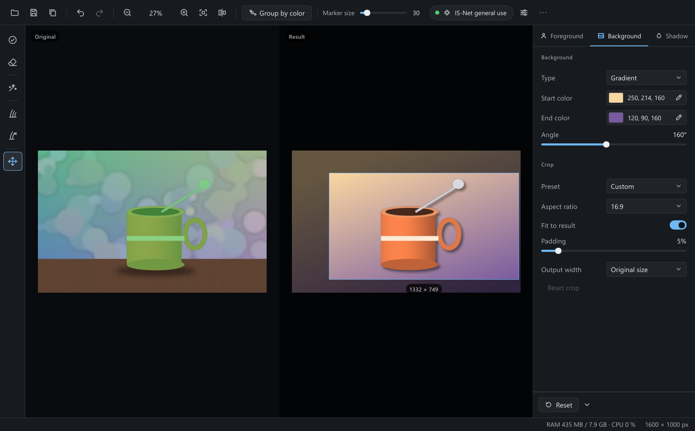
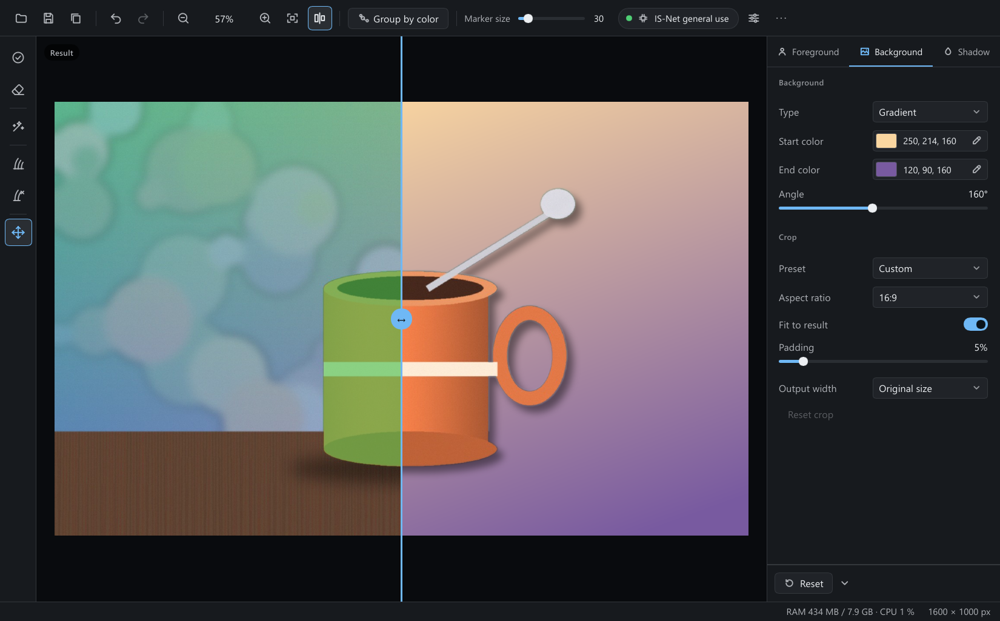

# OpenScissors

**Détourez le sujet d'une photo, hors ligne, sur votre propre machine.** Une IA propose le contour, vous le corrigez au pinceau, puis vous posez le résultat sur un fond transparent, uni ou une image (avec une ombre si vous voulez) et vous exportez.

[](LICENSE)
[](https://www.rust-lang.org)
[](https://slint.dev)
[](#obtenir-lappli)
[-success)](#portable-pour-de-vrai)
[](#vie-privée)

*English: [README.md](README.md)*

<p align="center">
  
</p>

## À voir en 100 secondes

<!-- Glissez brag.mp4 dans l'éditeur GitHub, puis collez l'URL de la vidéo qu'il vous donne (https://github.com/user-attachments/assets/...) seule sur une ligne juste sous ce commentaire : GitHub l'affiche comme un lecteur vidéo. -->

> Projet indépendant, sans lien avec un produit commercial. Il ne contient ni code, ni icônes, ni traductions, ni poids de modèle venant d'un tel produit.

## Pourquoi

Je voulais un outil de détourage qui

- fonctionne **hors ligne** (vos photos ne quittent jamais l'ordinateur),
- démarre instantanément et **ne mange pas la moitié de la RAM** pour rester ouvert,
- permet de **corriger** le résultat au lieu d'espérer que l'IA ait tout bon,
- tient dans **un seul dossier** à copier sur une clé USB.

Voilà. Environ 240 Mo de mémoire avec une photo ouverte (modèle non compté), 28 Mo au repos.

## Ce que ça fait

- **Détourage automatique** dès l'ouverture d'une image. Le résultat s'affiche à côté de l'original ; les deux vues zooment et se déplacent ensemble.
- **Correction au pinceau** : marquer ce qu'il faut garder, effacer ce qui dépasse, et un outil **cheveux** pour des bords doux.
- **Corrections du masque en un clic** : boucher les trous, retirer les taches, garder la plus grande partie, durcir les bords flous ou inverser le masque, chacune annulable en une étape.
- **Grouper par couleur** (traits verts et rouges) quand l'IA hésite : les zones de couleur proche suivent vos traits.
- **Sélection intelligente** : cliquez ce que vous voulez, clic droit ce que vous ne voulez pas, ou tracez un cadre (modèle SAM 2, léger).
- **Fonds** : transparent, couleur unie, dégradé (deux couleurs et un angle), une image, ou l'original avec le sujet comblé : la texture autour (un mur, de l'herbe, un sol) est prolongée derrière lui, morceau par morceau, en une seconde environ en arrière-plan, avec un remplissage lisse affiché en attendant. Flou, niveaux de gris, négatif, pixellisation ou coloration sur l'une ou l'autre couche. Une pipette près de chaque couleur la prend dans l'image.
- **Nettoyage des bords** : les bords doux (cheveux, adoucissement) perdent la couleur de l'ancien fond, donc aucun halo sur le nouveau.
- **Réglage des couleurs** du sujet seul (luminosité, saturation, chaleur) pour qu'il s'accorde à son nouveau fond.
- **Ombre** (flou, opacité, couleur, décalage vers la droite et le bas), **recadrage à un ratio, marge**, puis export en PNG, JPEG, WebP, AVIF, TIFF ou BMP. Les sources 16 bits peuvent rester en 16 bits. Le réglage de qualité pilote JPEG, WebP et AVIF ; WebP à 100 est sans perte, en dessous il est avec perte (la transparence reste exacte). WebP accepte au plus 16383 px de côté. Une résolution d'impression (DPI, dans les réglages) peut être écrite dans les fichiers PNG, JPEG et TIFF, pour qu'ils s'impriment à la taille voulue. Les fichiers TIFF sont compressés sans perte (Deflate). Une taille de fichier maximale (dans les réglages, `--max-size 500k` en ligne de commande) baisse la qualité des fichiers JPEG, WebP et AVIF juste assez pour qu'ils y tiennent. **Exporter le masque…** (dans le menu) enregistre le masque seul en PNG gris à la taille de l'image, pour un autre logiciel, et **Exporter les calques (PSD)…** un fichier Photoshop avec la photo et le détourage en calques, le masque modifiable comme masque de calque (le fond, le recadrage et les effets restent dans OpenScissors).
- **Taille de sortie et préréglages** (marketplace 1000 ou 2000 px, miniature, bannière 16:9) : saisissez une largeur, une hauteur, ou les deux pour une taille exacte comme 1200 × 627 (le recadrage prend alors ce ratio) ; le résultat sort à la taille exacte, centré, sur fond blanc ou transparent.
- **Le canevas peut dépasser l'image** : quand un ratio ou la marge demande plus de place que la photo n'en a (une bannière 16:9 d'une photo carrée), le fond remplit la zone ajoutée au lieu de couper le sujet. Vous pouvez aussi tirer le recadrage au-delà des bords, ou le déplacer avec <kbd>Alt</kbd>+flèches ; une grille des tiers aide à placer le sujet, et l'image tourne d'un quart ou se retourne en miroir en un clic (une étape à annuler). Le canevas ne dépasse jamais le double de la taille de l'image.
- **Profils colorimétriques** : une image avec un profil intégré (Display P3, Adobe RGB...) est convertie en sRGB à l'ouverture, donc les couleurs sont justes (les gamuts larges sont écrêtés à sRGB) ; les exports d'une telle image portent le profil sRGB.
- **Images déjà détourées** (un PNG ou WebP avec transparence) : elles s'ouvrent avec leur propre transparence, sans modèle ; on peut affiner le masque ou changer le fond.
- **Avant et après** : le bouton à côté du zoom (ou <kbd>C</kbd>) fusionne les deux vues en une seule, avec une barre à faire glisser : l'original d'un côté, le résultat de l'autre.
- **Rien de perdu** : le travail en cours est enregistré chaque minute ; si l'appli ou le PC s'arrête, il est proposé au démarrage suivant. Fermer une image qui a des marques propose d'enregistrer un projet, qui les garde (une image exportée ne les garde pas).
- **Copier-coller** : <kbd>Ctrl</kbd>+<kbd>V</kbd> ouvre l'image du presse-papiers, avec sa transparence si elle est déjà détourée (ou un fichier image copié dans l'explorateur) ; un clic, ou <kbd>Ctrl</kbd>+<kbd>C</kbd>, copie le résultat avec sa transparence.
- **Traitement par lot** d'un dossier entier : déposez le dossier sur la fenêtre, avec vos réglages enregistrés ou ceux de l'image en cours, en PNG, JPEG, WebP ou AVIF. Les sous-dossiers peuvent être inclus (chaque résultat va dans le même sous-dossier), les images déjà traitées laissées de côté (pour finir un lot interrompu), un suffixe ajouté aux noms (`photo-detoure.png`) et un rapport JSON enregistré à côté des résultats. Un suffixe avec `--suffix` en ligne de commande aussi.
- **4 langues** : English (par défaut), Français, Deutsch, Русский.
- **Plug-ins** (optionnels, désactivés tant que vous ne les activez pas) : de petits programmes lancés sur le fichier que vous venez d'enregistrer.

<p align="center">
  
  
</p>
<p align="center">
  
  
</p>
<p align="center">
  
  
</p>

## Obtenir l'appli

Windows 10/11 (64 bits), Linux x64 et macOS sur Apple Silicon ont chacun leur build sur la page Releases.

1. Téléchargez le dernier zip pour votre système depuis la page Releases (`OpenScissors-…-portable-win-x64.zip`, `…-linux-x64.zip` ou `…-darwin-arm64.zip`) et décompressez-le où vous voulez.
2. Lancez `OpenScissors.exe` (`OpenScissors` sous Linux et macOS).
3. Ouvrez une image (le bouton, <kbd>Ctrl</kbd>+<kbd>O</kbd>, glisser-déposer, coller avec <kbd>Ctrl</kbd>+<kbd>V</kbd>, ou `OpenScissors.exe photo.jpg`).

Au premier lancement, aucun modèle d'IA n'est installé (ils ne sont pas fournis). Cliquez sur la pastille en haut, choisissez-en un, **Télécharger**. Le fichier est vérifié par SHA-256 avant usage. Un téléchargement coupé (annulé, connexion perdue, ou plus rien reçu pendant une minute) reprend là où il s'était arrêté au prochain **Télécharger** ; un fichier déjà présent est revérifié avant d'être utilisé.

| Modèle | Téléchargement | Mémoire | Pour |
|---|---|---|---|
| **IS-Net** (par défaut) | 179 Mo | ~0,6 Go | la plupart des photos, moins d'une seconde |
| BiRefNet lite | 224 Mo | ~5 Go | cheveux et structures fines, quelques secondes |
| BiRefNet lite, demi-précision | 115 Mo | ~5 Go | pareil, pensé pour les GPU |
| BiRefNet complet | 973 Mo | lourd | meilleure qualité, lent sur processeur |
| SAM 2.1 tiny | 156 Mo | ~1 Go pendant la sélection | l'outil Sélection intelligente |

L'appli prend le modèle le plus léger que vous avez tant que vous n'en choisissez pas un autre, et refuse un modèle qui ne tiendrait pas dans son budget mémoire plutôt que de figer votre PC.

## Portable pour de vrai

Tout ce que l'appli écrit reste dans son dossier :

```
OpenScissors/
├── OpenScissors.exe
├── openscissors-cli.exe   le même moteur dans un terminal
├── DirectML.dll        seulement pour le mode GPU optionnel
├── models/             ce que vous avez téléchargé
├── data/               réglages, position de la fenêtre, vos défauts
├── temp/               fichiers temporaires (nettoyés automatiquement)
└── licenses/
```

Supprimez `data/` pour repartir de zéro, `models/` pour libérer de la place. Rien n'est écrit dans le registre ni dans votre profil. (Si le dossier est en lecture seule, par exemple Program Files, l'appli se rabat sur votre profil plutôt que d'échouer.)

## Léger par défaut, lourd si vous le demandez

- Rien n'est chargé au lancement. Le modèle se charge avec votre première image.
- L'appli reste sous **25 % de votre RAM** (50 % dans les *Réglages*, si vous avez la mémoire et la patience pour BiRefNet).
- Les grandes photos sont traitées par bandes : une 8K coûte quelques centaines de Mo, pas des gigaoctets.
- La barre du bas affiche en direct la RAM et le CPU utilisés par l'appli.

## Raccourcis

| | |
|---|---|
| <kbd>F</kbd> garder · <kbd>B</kbd> supprimer (en *Grouper par couleur*) · <kbd>E</kbd> gomme | <kbd>S</kbd> sélection intelligente · <kbd>H</kbd> cheveux · <kbd>Maj</kbd>+<kbd>H</kbd> gomme cheveux |
| <kbd>M</kbd> déplacer · <kbd>Espace</kbd> maintenu pour faire glisser | <kbd>[</kbd> <kbd>]</kbd> taille du pinceau |
| <kbd>Alt</kbd>+flèches déplacent le recadrage de 1 px (<kbd>Maj</kbd> : 10 px) | les flèches déplacent les vues · <kbd>C</kbd> avant / après |
| <kbd>Ctrl</kbd>+<kbd>O</kbd> ouvrir · <kbd>Ctrl</kbd>+<kbd>S</kbd> enregistrer (le projet s'il y en a un, sinon le résultat) · <kbd>Ctrl</kbd>+<kbd>Maj</kbd>+<kbd>S</kbd> enregistrer le résultat sous | <kbd>Ctrl</kbd>+<kbd>Z</kbd> / <kbd>Y</kbd> annuler / rétablir |
| <kbd>Ctrl</kbd>+<kbd>V</kbd> coller une image | <kbd>Ctrl</kbd>+<kbd>C</kbd> copier le résultat |
| <kbd>Page suiv.</kbd> / <kbd>Page préc.</kbd> image suivante / précédente du dossier, avec les mêmes réglages | |
| <kbd>Ctrl</kbd>+<kbd>0</kbd> 100 % · <kbd>Ctrl</kbd>+<kbd>9</kbd> ajuster · <kbd>Ctrl</kbd>+<kbd>+</kbd> / <kbd>-</kbd> zoom | molette : déplacer, <kbd>Ctrl</kbd>+molette : zoomer |
| <kbd>Entrée</kbd> appliquer une sélection · <kbd>Retour arrière</kbd> retirer le dernier clic · <kbd>Échap</kbd> annuler | |

Le pinceau est **désactivé par défaut** : l'appli démarre sur l'outil *Déplacer*, le curseur ne peint donc jamais par surprise. Les raccourcis suivent les caractères des touches et marchent donc aussi sur un clavier AZERTY : Ctrl+à et Ctrl+ç zooment comme Ctrl+0 et Ctrl+9, AltGr+( et AltGr+) donnent les touches de taille du pinceau [ et ].

## Vie privée

Aucun compte, aucune télémétrie, aucun appel réseau hormis les téléchargements de modèles que vous lancez vous-même (HTTPS, somme de contrôle vérifiée).

## Compiler soi-même

Il suffit de Rust (stable, 1.92 ou plus récent).

```bash
cargo run -p openscissors --release                 # lancer
cargo test --workspace                              # tests
node scripts/package-portable.mjs --build --zip     # le dossier portable et son zip, dans dist/
```

Les builds de debug (de l'appli et de la ligne de commande) gardent leurs données dans `portable-dev/`. `OPENSCISSORS_HOME` pointe les deux vers un autre dossier ; la ligne de commande utilise toujours le même dossier que l'appli, repli dans le profil compris, `OPENSCISSORS_MODEL=/chemin/model.onnx` charge un fichier local de type IS-Net.

Un outil en ligne de commande existe aussi : `cargo run -p openscissors-cli -- cut photo.jpg detourage.png` (et `predict`, `batch`, `models`). `batch photos/ sortie/ --recursive` prend aussi les sous-dossiers et écrit chaque résultat dans le même sous-dossier de `sortie/` ; `--jobs 4` traite quatre images à la fois (chacune demande sa propre mémoire, et comme une image occupe déjà tous les cœurs le gain est faible : 10 à 15 % mesurés sur des photos JPEG, aucun en AVIF) ; `--resume` (formats png, jpg, webp, avif, tiff, bmp) laisse de côté les images dont le résultat est déjà dans `sortie/` : relancer la même commande après une erreur ou une interruption ne fait que le reste (deux images de même nom, `a.jpg` et `a.png`, donnent `a_jpg.png` et `a_png.png`) ; les images déjà détourées gardent leur transparence et les images 16 bits restent en 16 bits en PNG (`--8bit` le désactive), comme à l'export depuis la fenêtre ; `--dpi 300` écrit la résolution d'impression dans les fichiers PNG, JPEG et TIFF ; `--gpu` (aussi pour `cut`, `predict` et `compare`) fait tourner le modèle sur la carte graphique quand c'est possible, sur le processeur sinon ; `--preset banner`, `--bg white` (ou `transparent`, `black`, `#ff8800`), `--width 1200 --height 627` règlent l'aspect et la taille de chaque résultat, après les réglages enregistrés dans l'application quand `--defaults` est là ; `cut` prend les mêmes options pour une image et écrit tous les formats (`cut photo.jpg sortie.jpg --bg white --width 1000`), et `-` lit l'image depuis un tube ou y écrit le résultat (`cat photo.jpg | openscissors-cli cut - - --format webp > sortie.webp`) ; `--report rapport.json` écrit une entrée par image (faite, ignorée ou en échec, le fichier écrit, l'erreur, la durée). `compare photo.jpg sortie/` fait tourner chaque modèle téléchargé (ou `--models a,b`) sur une image, l'un après l'autre, et écrit chaque masque, une planche-contact et l'accord entre les modèles. `models --json` donne le catalogue pour un script (tous les champs, si chaque modèle est téléchargé et où) ; `models download <id>` reprend un téléchargement coupé et `models verify <id>` vérifie les fichiers par leur SHA-256.

Pour regarder l'interface et la piloter sans toucher la souris (pratique pour les tests et les captures) :

```bash
cargo run --release -p openscissors --example selftest -- photo.jpg sortie/ [tour|keys|flows|all|script etapes.json]
```

### Utiliser votre propre modèle

Créez `models/<nom>/model.onnx` et un `model.json` à côté :

```json
{
  "id": "mon-modele", "name": "Mon modèle", "license": "MIT",
  "input_size": [1024, 1024],
  "mean": [0.485, 0.456, 0.406], "std": [0.229, 0.224, 0.225],
  "output": "sigmoid"
}
```

`output` vaut `sigmoid` (le modèle rend des logits), `minmax` (la sortie brute est remise à l'échelle) ou `none` (déjà entre 0 et 1). Les modèles sont décrits par des données seulement : en ajouter un ne demande jamais de modifier le code. Les noms de fichiers (`file_name`, `files`) sont de simples noms dans ce dossier : un `model.json` qui pointe ailleurs est ignoré.

### Plug-ins

Un plug-in est un dossier `plugins/<id>/` à côté de `models/`, avec un `plugin.json` :

```json
{ "id": "optimize-png", "name": "Optimiser le PNG", "description": "Lance oxipng sur le résultat",
  "command": "run.cmd", "args": ["{input}"], "extensions": ["png"] }
```

`command` est un fichier de ce dossier : un `.cmd`, `.bat` ou `.exe` sous Windows (l'exemple ci-dessus est pour Windows), un script exécutable comme `run.sh` sous Linux et macOS. `{input}` est le fichier que vous venez d'enregistrer et `{dir}` son dossier. Un plug-in ne fait rien tant que vous ne l'activez pas dans les *Réglages* ; il ne s'exécute ensuite que quand vous cliquez sur **Lancer sur le dernier fichier enregistré** (limite de 60 s, les dernières lignes de sa sortie sont affichées). Quand le temps est écoulé, ou quand le plug-in laisse un programme tourner derrière lui, ce programme est arrêté avec tout ce qu'il a lancé. C'est un programme que vous avez installé : OpenScissors ne lui ajoute aucune permission.

## Comment c'est fait

- `crates/core` : tout ce qui n'est pas une fenêtre. Lecture/écriture d'images, exécution des modèles (ONNX Runtime), GrabCut et max-flow, matting, SAM 2, le document et son historique, rendu et export. Aucune dépendance graphique, donc facile à tester.
- `crates/app` : la fenêtre, écrite avec [Slint](https://slint.dev) et son moteur de rendu logiciel (≈ 100 Mo de gagnés face à un rendu GPU, beaucoup plus face à une vue web).
- `crates/cli` : la ligne de commande.

Détails dans [docs/ARCHITECTURE.md](docs/ARCHITECTURE.md) et [docs/PERF.md](docs/PERF.md) (mémoire et vitesse, mesurées).

## Limites connues

- Le mode GPU (DirectML) fonctionne mais n'a rien accéléré sur la carte essayée ; il reste optionnel.
- Les images à gamut large sont converties en sRGB : les couleurs hors sRGB sont écrêtées. L'AVIF s'écrit mais ne s'ouvre pas.
- Le fonctionnement avec un lecteur d'écran (voir [docs/PERF.md](docs/PERF.md)) n'a pas été testé avec un vrai lecteur d'écran.
- Une image est refusée, avec un message, quand elle ne tiendrait pas dans le budget mémoire (environ 24 octets par pixel une fois ouverte : une photo 8K demande ~0,8 Go, 100 mégapixels ~2,3 Go) ou dépasse 500 mégapixels. L'historique d'annulation ne garde qu'environ 384 Mo (un sixième du budget mémoire sur une petite machine) : les plus anciennes étapes sont oubliées en premier.
- Les traductions n'ont pas été relues par des locuteurs natifs. Les corrections sont les bienvenues.

## Licence

Apache-2.0. Voir [LICENSE](LICENSE), [NOTICE](NOTICE) et [THIRD_PARTY.md](THIRD_PARTY.md).

La bibliothèque d'interface, Slint, est utilisée sous la **Slint Royalty-free License 2.0** (gratuite pour les applications de bureau, avec l'attribution *Made with Slint* visible dans **Menu → À propos**). Slint existe aussi en GPL-3.0, ce qui rendrait un build d'OpenScissors GPL-3.0 dans son ensemble ; chacun choisit la licence qui lui convient en compilant les sources. Ceci n'est pas un avis juridique.

Les modèles sont des œuvres distinctes, avec leurs propres licences (MIT, Apache-2.0), listées dans [THIRD_PARTY.md](THIRD_PARTY.md).
