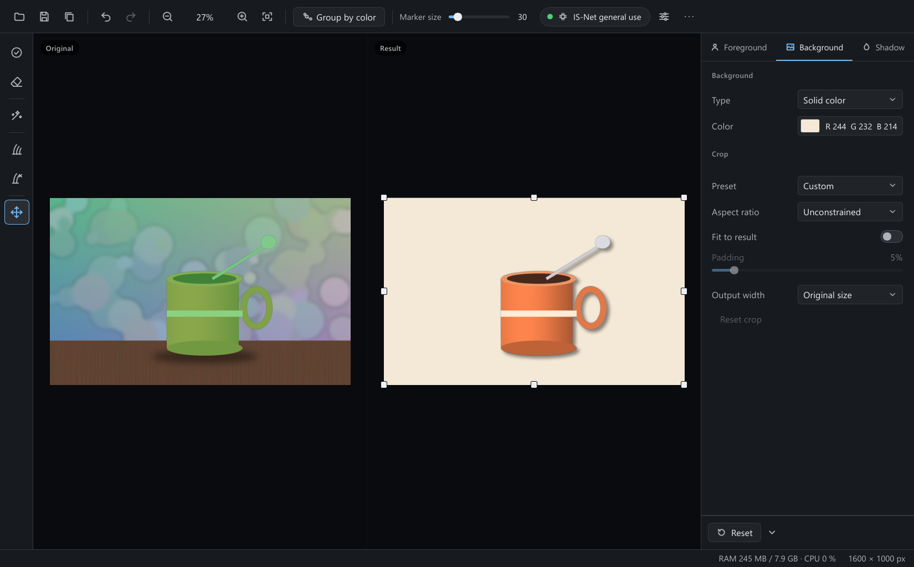
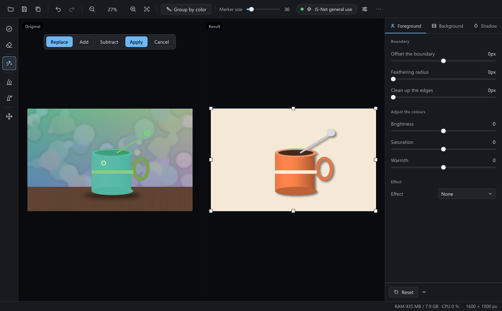
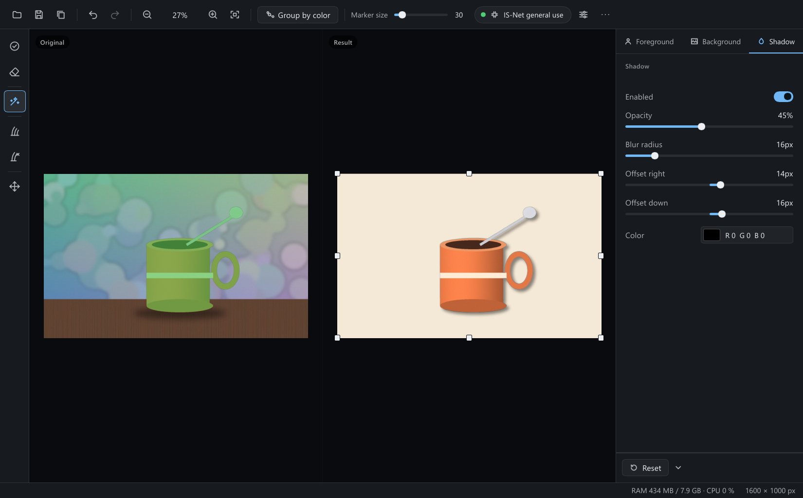
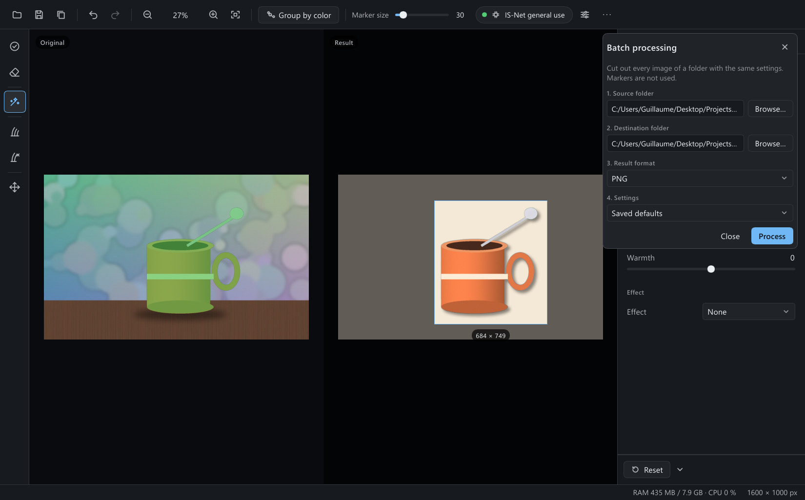
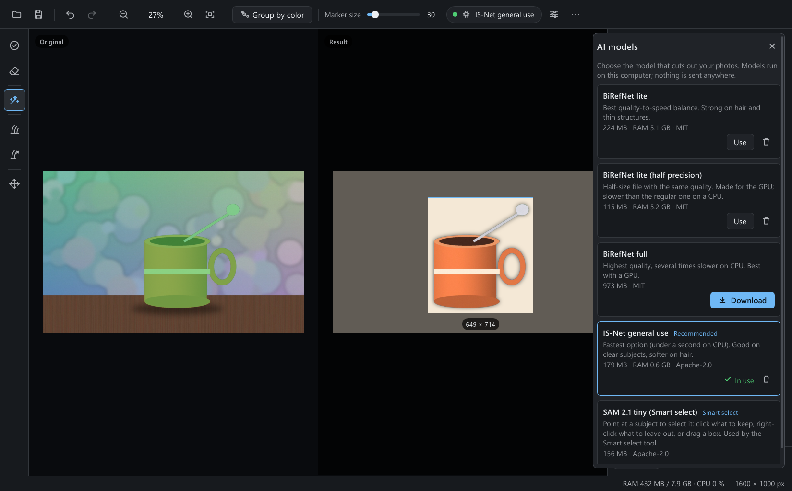

# OpenScissors

**Cut the subject out of a photo, offline, on your own machine.** An AI proposes the outline, you fix it with a brush, then you drop the result on a transparent, plain or picture background (with a shadow if you like) and export.

[](LICENSE)
[](https://www.rust-lang.org)
[](https://slint.dev)
[](#get-it)
[-success)](#portable-by-design)
[](#privacy)

*Français : [README.fr.md](README.fr.md)*

<p align="center">
  
</p>

> This is an independent project. It is not affiliated with any commercial product, and it contains no code, icons, translations or model weights from one.

## Why

I wanted a background remover that

- works **offline** (your photos never leave the computer),
- starts in a blink and **doesn't eat half the RAM** just to sit there,
- lets me **correct** the result instead of hoping the AI got it right,
- comes as **one folder** I can copy to a USB stick.

So that's what this is. About 240 MB of memory with a photo open (not counting the model), 28 MB when it is idle.

## What you get

- **Automatic cut-out** the moment you open an image. The result appears next to the original; both views zoom and pan together.
- **Brush correction**: mark what to keep, erase what shouldn't be there, and a *hair* tool for soft edges.
- **Group by color** (green and red marks) when the AI struggles: whole areas of similar colour follow your strokes.
- **Smart select**: click what you want, right-click what you don't, or drag a box (needs the small SAM 2 model).
- **Backgrounds**: transparent, solid colour, any picture, or the original with the subject filled in. Blur, grayscale, negative, pixelate or colourize either layer.
- **Clean up the edges**: soft edges (hair, feathering) lose the colour of the old background, so no halo shows on the new one.
- **Adjust the colours** of the subject alone (brightness, saturation, warmth) so it sits right on its new background.
- **Shadow** (blur, opacity, colour, offset right and down), **crop to a ratio, padding**, then export to PNG, JPEG, WebP, TIFF or BMP. 16-bit sources can stay 16-bit.
- **Output width and presets** (marketplace 1000 or 2000 px, thumbnail, 16:9 banner): the result comes out at the exact size, centred, on white or transparent.
- **Copy and paste**: <kbd>Ctrl</kbd>+<kbd>V</kbd> opens the picture on the clipboard (or an image file copied in your file manager); one click, or <kbd>Ctrl</kbd>+<kbd>C</kbd>, copies the result with its transparency.
- **Batch mode** for a whole folder: drop the folder on the window, use your saved settings or those of the image you are editing, save as PNG, JPEG or WebP.
- **4 languages**: English (default), Français, Deutsch, Русский.
- **Plug-ins** (optional, off until you turn them on): small programs that run on the file you just saved.

<p align="center">
  
  
</p>
<p align="center">
  
  
</p>

## Get it

Windows 10/11 (64-bit) is the tested platform. The Releases page also has a Linux x64 build and a macOS Apple Silicon build, untested.

1. Download the latest zip for your system from the Releases page (`OpenScissors-…-portable-win-x64.zip`, `…-linux-x64.zip` or `…-darwin-arm64.zip`) and unzip it anywhere.
2. Run `OpenScissors.exe` (`OpenScissors` on Linux and macOS).
3. Open an image (the button, <kbd>Ctrl</kbd>+<kbd>O</kbd>, drag and drop, paste with <kbd>Ctrl</kbd>+<kbd>V</kbd>, or `OpenScissors.exe photo.jpg`).

The first time, no AI model is installed (they are not bundled). Click the chip at the top, pick one, press **Download**. The file is checked against a SHA-256 before it is used.

| Model | Download | Memory | Good for |
|---|---|---|---|
| **IS-Net** (default) | 179 MB | ~0.6 GB | most photos, under a second |
| BiRefNet lite | 224 MB | ~5 GB | hair and thin structures, a few seconds |
| BiRefNet lite, half precision | 115 MB | ~5 GB | the same, made for GPUs |
| BiRefNet full | 973 MB | heavy | best quality, slow on a CPU |
| SAM 2.1 tiny | 156 MB | ~1 GB while selecting | the Smart select tool |

The app picks the lightest model you have until you choose another one, and refuses a model that wouldn't fit in its memory budget instead of freezing your PC.

## Portable by design

Everything the application writes stays in its own folder:

```
OpenScissors/
├── OpenScissors.exe
├── openscissors-cli.exe   the same engine in a terminal
├── DirectML.dll        only used by the optional GPU mode
├── models/             what you downloaded
├── data/               settings, window position, your saved defaults
├── temp/               scratch files (cleaned automatically)
└── licenses/
```

Delete `data/` to start over, delete `models/` to free space. Nothing is written to the registry or to your profile. (If the folder is read-only, for example Program Files, the app falls back to your user profile rather than failing.)

## Light by default, heavy if you ask

- Nothing is loaded at start. The model loads with your first image.
- The app keeps to **25 % of your RAM** (50 % in *Settings*, if you have the memory and the patience for BiRefNet).
- Big photos are handled in bands, so an 8K image costs a few hundred MB, not gigabytes.
- The footer shows the live RAM and CPU use of the app.

## Shortcuts

| | |
|---|---|
| <kbd>F</kbd> keep · <kbd>B</kbd> remove (in *Group by color*) · <kbd>E</kbd> erase | <kbd>S</kbd> smart select · <kbd>H</kbd> hair · <kbd>Shift</kbd>+<kbd>H</kbd> erase hair |
| <kbd>M</kbd> move · hold <kbd>Space</kbd> to pan | <kbd>[</kbd> <kbd>]</kbd> brush size |
| <kbd>Ctrl</kbd>+<kbd>O</kbd> open · <kbd>Ctrl</kbd>+<kbd>S</kbd> save · <kbd>Ctrl</kbd>+<kbd>Shift</kbd>+<kbd>S</kbd> save as | <kbd>Ctrl</kbd>+<kbd>Z</kbd> / <kbd>Y</kbd> undo / redo |
| <kbd>Ctrl</kbd>+<kbd>V</kbd> paste an image | <kbd>Ctrl</kbd>+<kbd>C</kbd> copy the result |
| <kbd>Ctrl</kbd>+<kbd>0</kbd> 100 % · <kbd>Ctrl</kbd>+<kbd>9</kbd> fit · <kbd>Ctrl</kbd>+<kbd>+</kbd> / <kbd>-</kbd> zoom | wheel pans, <kbd>Ctrl</kbd>+wheel zooms |
| <kbd>Enter</kbd> apply a smart selection · <kbd>Backspace</kbd> remove the last click · <kbd>Esc</kbd> cancel | |

The brush is **off by default**: the app starts on the *Move* tool, so the pointer never paints by surprise.

## Privacy

No account, no telemetry, no network call except the model downloads you start yourself (HTTPS, checksum verified).

## Build it yourself

You only need Rust (stable).

```bash
cargo run -p openscissors --release                 # run it
cargo test --workspace                              # tests
node scripts/package-portable.mjs --build --zip     # the portable folder (with the CLI) and its zip, in dist/
```

Debug builds keep their data in `portable-dev/`. `OPENSCISSORS_HOME` points the app to another folder, and `OPENSCISSORS_MODEL=/path/model.onnx` loads a local IS-Net style file.

There is a command line tool too: `cargo run -p openscissors-cli -- cut photo.jpg cutout.png` (also `predict`, `batch`, `models`).

To look at the interface and drive it without touching the mouse (handy for tests and screenshots):

```bash
cargo run --release -p openscissors --example selftest -- photo.jpg out/ [tour|keys|flows|all|script steps.json]
```

### Using your own model

Create `models/<name>/model.onnx` and a `model.json` next to it:

```json
{
  "id": "my-model", "name": "My model", "license": "MIT",
  "input_size": [1024, 1024],
  "mean": [0.485, 0.456, 0.406], "std": [0.229, 0.224, 0.225],
  "output": "sigmoid"
}
```

`output` is `sigmoid` (the model returns logits), `minmax` (rescale the raw output) or `none` (already 0..1). Models are described by data only, so adding one never needs a code change.

### Plug-ins

A plug-in is a folder `plugins/<id>/` next to `models/`, with a `plugin.json`:

```json
{ "id": "optimize-png", "name": "Optimise PNG", "description": "Runs oxipng on the result",
  "command": "run.cmd", "args": ["{input}"], "extensions": ["png"] }
```

`command` is a file inside that folder: a `.cmd`, `.bat` or `.exe` on Windows (the example above is a Windows one), an executable script such as `run.sh` on Linux and macOS. `{input}` is the file you just saved and `{dir}` its folder. A plug-in does nothing until you turn it on in *Settings*, then it runs only when you press **Run on the last saved file** (60 s limit, the last lines of its output are shown). When the time is over, or when the plug-in leaves a program running behind it, that program is stopped together with everything it started. It is a program you installed: OpenScissors adds no permission of its own.

## How it is put together

- `crates/core`: everything that isn't a window. Image I/O, the model runner (ONNX Runtime), the GrabCut and max-flow code, closed-form matting, SAM 2, the document with its undo stack, rendering and export. No GUI dependency, so it is easy to test.
- `crates/app`: the window, written with [Slint](https://slint.dev) and its software renderer. That choice alone saves ~100 MB compared to a GPU renderer, and a lot more compared to a web view.
- `crates/cli`: the command line.

More in [docs/ARCHITECTURE.md](docs/ARCHITECTURE.md) and [docs/PERF.md](docs/PERF.md) (memory and speed, measured).

## Known limits

- Windows is the platform I test. The code is portable, the Linux and macOS (Apple Silicon) builds are untested. There is no macOS Intel build: ONNX Runtime provides no binary for it.
- The GPU mode (DirectML) works but didn't make anything faster on the card I tried, so it stays optional.
- Moving the crop with the keyboard isn't there yet; the handles need a pointer.
- A picture is refused, with a message, when it would not fit the memory budget (about 24 bytes per pixel once opened: an 8K photo needs ~0.8 GB, 100 megapixels ~2.3 GB) or is over 500 megapixels. The undo history keeps at most about 384 MB: the oldest steps are forgotten first.
- Error messages coming from the Rust side are in English only.
- The translations haven't been reviewed by native speakers. Corrections are welcome.

## License

Apache-2.0. See [LICENSE](LICENSE), [NOTICE](NOTICE) and [THIRD_PARTY.md](THIRD_PARTY.md).

The interface toolkit, Slint, is used under the **Slint Royalty-free License 2.0** (free for desktop apps, with the *Made with Slint* attribution you can find in **Menu → About**). Slint can also be used under GPL-3.0, which would make a build of OpenScissors GPL-3.0 as a whole; whoever builds the source picks the license that suits them. This is not legal advice.

Models are separate works with their own licenses (MIT, Apache-2.0), listed in [THIRD_PARTY.md](THIRD_PARTY.md).
